# VARAGH features

This page lists everything VARAGH (up to 1.3.1 "Lion") adds to or changes in
[CrossInk](https://github.com/uxjulia/crossink) v1.6.0. Everything CrossInk and
CrossPoint already do (EPUB/TXT/XTC reading, fonts from the SD card, KOReader
sync, Calibre, OPDS, reading stats, Quick Actions, and so on) is still there;
see [CrossInk's README](https://github.com/uxjulia/crossink#readme) for those.

VARAGH runs on the **Xteink X4 Pro**, the **X4 Classic** and the **X3 / X4**. The
X4 Pro has a touch screen and a front light; the X4 Classic and X3 / X4 do every
feature with the buttons (see [section 21](#21-readers-without-touch)).

Every screen on this page shows VARAGH 1.3.1, captured from the release firmware
in the [Reader Simulator](https://pewpewzxc.github.io/reader-simulator/) (X4 Pro,
and in section 21 the X4 Classic and X3). Only the picture comparisons in section 7
show older firmware on purpose: they compare 1.0.1 with 1.1.0, and are computed,
not photographed.

**Nothing to set up after installing (1.3.1).** English, German, Persian and
pronunciation letters display with the built-in fonts on every reader. The
NotoVazir font from the SD-card zip is optional (see [section 1](#notovazir-font-optional)).

---

## Contents

1. [Persian and Arabic](#1-persian-and-arabic)
2. [German → English dictionary](#2-german--english-dictionary)
3. [Touch word selection](#3-touch-word-selection)
4. [Highlights](#4-highlights)
5. [Flashcards](#5-flashcards)
6. [Swipe to delete](#6-swipe-to-delete)
7. [Speed, pictures and battery](#7-speed-pictures-and-battery)
8. [Clock: summer time, sync and Live Clock](#8-clock-summer-time-sync-and-live-clock)
9. [Pronunciations in menus](#9-pronunciations-in-menus)
10. [VARAGH name and logo](#10-varagh-name-and-logo)
11. [Safe updates](#11-safe-updates)
12. [Apps](#12-apps)
13. [Online dictionary](#13-online-dictionary)
14. [Book ratings](#14-book-ratings)
15. [Dictionaries for every language](#15-dictionaries-for-every-language)
16. [Control Center and night light](#16-control-center-and-night-light)
17. [Settings in groups](#17-settings-in-groups)
18. [Books as they were made](#18-books-as-they-were-made)
19. [Bluetooth page turner](#19-bluetooth-page-turner)
20. [Icons, rotation and battery icon](#20-icons-rotation-and-battery-icon)
21. [Readers without touch](#21-readers-without-touch)
22. [For developers](#22-for-developers)
23. [Planned](#23-planned)

---

## 1. Persian and Arabic

<table>
  <tr>
    <td align="center" width="33%" valign="top">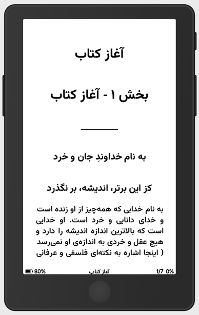 The Shahnameh in the built-in font (1.3.1).</td>
    <td align="center" width="33%" valign="top">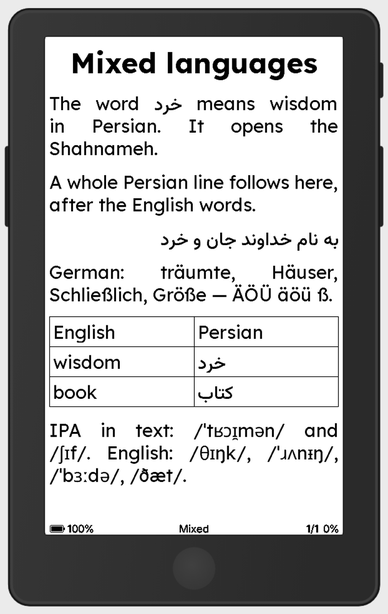 English, Persian, German and pronunciations on one page (1.3.1).</td>
    <td align="center" width="33%" valign="top">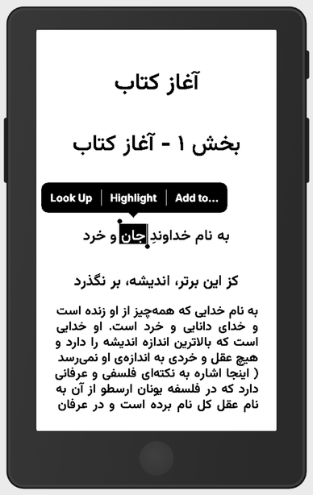 Holding a Persian word: handles and the Ask bubble.</td>
  </tr>
</table>

### Built in on every reader (1.3.1)
The built-in reading fonts carry the Persian and Arabic letters (Vazirmatn,
regular and bold, in four sizes) and the pronunciation letters dictionaries use (IPA, from
Noto Sans), on the X4 Pro, X4 Classic and X3 / X4. Persian books, German words in
a dictionary or flashcard, and pronunciations such as /θɪŋk/ or [haʊ̯s] display
straight after installing, with no font on the SD card. Before 1.3.1 they needed
NotoVazir and otherwise showed as diamonds.

### NotoVazir font (optional)
One reader font that contains every letter VARAGH needs. Install it if you want
Persian in more sizes, or italic English beside it:

| Part | Letters |
|---|---|
| Noto Serif (Medium, Bold, Italic, Bold Italic) | English, German and other Latin-script languages |
| Vazirmatn (Medium, Bold) | Persian and Arabic, with all joined letter forms |
| Noto Serif + Noto Sans Math | IPA pronunciation letters, arrows, math and other symbols |

- Sizes 10, 12, 14, 16, 18 and 20.
- Anti-aliased edges drawn slightly darker so text reads better on the X4 Pro screen.
- Install: copy `.fonts/NotoVazir` from `varagh-sd-card-*.zip` (in each release)
  to `/.fonts/NotoVazir/` on the SD card.
- Build it yourself: see [docs/varagh/FONTS.md](docs/varagh/FONTS.md).

### Persian books pick a font that can show them
When you open a book whose language is Persian, Arabic, Urdu, Pashto, Sindhi,
Uyghur or Kurdish (or whose title is written in Arabic script), and your reader
font has no Persian letters, VARAGH uses an installed font that does
(NotoVazir) **for that book only**. Your saved font setting is not changed.

### Persian and pronunciations with any reader font
You can choose another reader font, such as Bitter or Literata. When that font
has no Persian letters or pronunciation symbols, VARAGH draws those words in
NotoVazir (or, from 1.3.1, in the built-in font) at the same size, and the rest
of the text stays in your font. This works in:

- books,
- dictionary definitions,
- highlights,
- flashcards.

Covered: Arabic and Persian letters (U+0600–06FF, 0750–077F, 08A0–08FF, and
presentation forms FB50–FDFF and FE70–FEFF) and IPA (U+0250–02FF, 1D00–1DBF).
Up to 1.3.0, NotoVazir (or another installed font with those letters) had to be
in `/.fonts/`. From 1.3.1 nothing has to be installed: a downloaded font without
Persian letters, such as Bitter on the X3 / X4, borrows them from the built-in font.

### Mixed English and Persian (1.3.0, 1.3.1)
- A paragraph takes the direction of its first word: one that starts with an
  English word reads left to right even when Persian follows.
- Brackets around English words inside a Persian line face the right way.
- A kasra (and kasratan, hamza or alef below) under a letter that reaches below
  the line (خ ج ع, final ر ن م) is drawn below it instead of inside it.
- The Kurdish letter ە joins the letter before it.
- Guide Dots sit in the right place in right-to-left lines, and Persian lines in
  dictionary entries are laid out right to left (1.3.0).

### Focus Reading in Persian (1.3.1)

  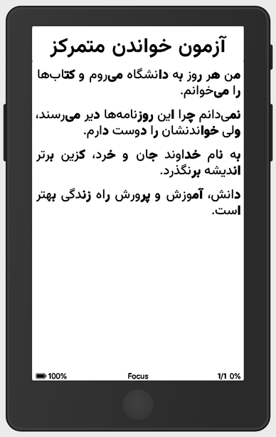 
  Focus Reading in a Persian book (no extra font).

Focus Reading bolds the start of every Persian word, as it does in English: the
first 40 % of the word's letters, rounded down and at least one (دانشگاه → **دا**نشگاه,
کتاب‌ها → **کت**اب‌ها, و → **و**). The letters stay joined where the bold ends, and a
half-space word (می‌روم) is one word. The bold is drawn a pixel heavier than
Vazirmatn Bold so it stands out on e-ink, with or without NotoVazir, on all three
readers.

### Persian menus and keyboard (1.3.0)
- **Persian is a menu language**, written right to left. From 1.3.1 it is a
  small download in **Settings → General → Language**, like the other 26
  download languages; English and Deutsch are built in.
- **Persian keyboard**: standard letter rows with پ چ ژ گ ک ی and a half-space
  key, in **Keyboard layouts**.
- **Caps Lock** on every keyboard: tap Shift twice or hold it; the key shows a
  bar under its arrow.

### Persian words in the dictionary
The Persian zero-width non-joiner (نیم‌فاصله) stays part of the word when you
select it for lookup, so words such as می‌روم are looked up whole. From 1.3.0
inflected Persian words find their dictionary form (می‌روم → رفتن, کتاب‌هایم →
کتاب), and Persian words use the Persian dictionary in any book.

  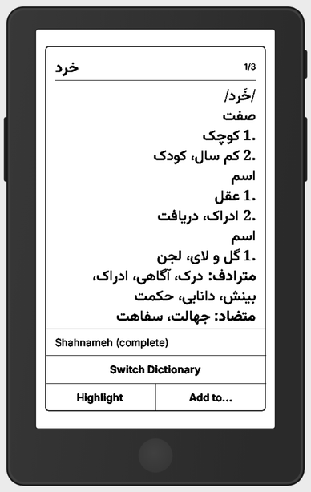

### Font converter
`fontconvert_sdcard.py` has a new `arabic` preset with every range Persian and
Arabic text needs, including the joined forms.

---

## 2. German → English dictionary

VARAGH ships no dictionary data (each has its own licence). The recommended
German → English dictionary is FreeDict's `deu-eng`, prepared with Inky's
dictionary tools; step-by-step instructions are in
[docs/varagh/DICTIONARIES.md](docs/varagh/DICTIONARIES.md). From 1.3.0 each
language you read has its own dictionary and online sources: see
[section 15](#15-dictionaries-for-every-language).

<table>
  <tr>
    <td align="center" width="50%" valign="top">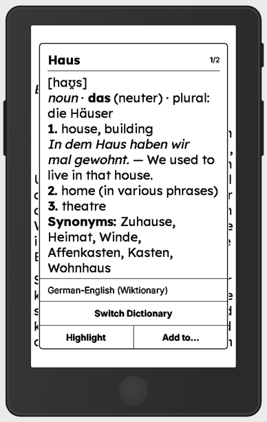 <b>Häuser</b> opens <b>Haus</b>: the German → English entry with its pronunciation [haʊ̯s], synonyms and related words.</td>
    <td align="center" width="50%" valign="top">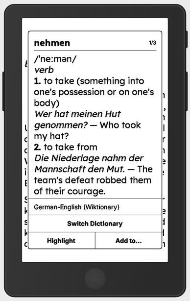 A tap on <b>nahm</b> opens <b>nehmen</b>; <b>Switch Dictionary</b>, <b>Highlight</b> and <b>Add to…</b> at the bottom.</td>
  </tr>
</table>

### Finds the dictionary form of German words
When a German word is not in the dictionary as written, VARAGH tries its base
forms, most likely first:

| You select | VARAGH finds | Rule |
|---|---|---|
| Häuser, Mütter, Äpfel | Haus, Mutter, Apfel | umlaut plurals |
| Lehrerinnen | Lehrerin | feminine plural |
| Kindern, schönen | Kind, schön | case and adjective endings |
| größeren, schönsten | groß, schön | comparative and superlative |
| macht, machst, machte, mache | machen | present and past tense |
| gemacht, gearbeitet, gefahren | machen, arbeiten, fahren | past participles |
| die gemachte Arbeit | machen | participles used as adjectives |
| aufgemacht, anzurufen | aufmachen, anrufen | separable verbs |
| Über (start of a sentence) | über | capital letter |

Irregular forms (ging, sah) come from the dictionary's own alternate-forms
file. From 1.3.0 that list of word forms is asked first, then spellings with
other capitals, then the guessed forms above, in English too: "nodes" finds
node, "cats" cat (not CATS), "went" go, "kamen" kommen. Looking up several words
tries the whole phrase first ("good fortune"), then the first word. German rules are used only when the dictionary translates *from* German
(its `lang` field, such as `de-en`, or a name such as "German-English").

### Repairs before lookup
- Curly apostrophes become straight ones (don’t → don't), as headwords use them.
- A hyphen typed into the book text in the middle of a word is removed
  (Geschwin-digkeit → Geschwindigkeit), which is common in books converted from PDF.

### Better word selection
- Punctuation ends a word: "Wort,Wort", "Wort...Wort" and "Wort/Wort" select one word.
- Characters that join words are kept when they sit between letters:
  apostrophes (l'été, don't), hyphens (mother-in-law), abbreviation dots (z.B.),
  the Catalan middle dot and the Persian zero-width (non-)joiners.
- Words split across lines: a hyphen the layout added is dropped
  (exter- / nity → externity), and a hyphen from the book text is kept
  (self- / aware → self-aware).

### Remembers your dictionary
The dictionary you pick with **Switch Dictionary** stays the default for later
lookups. If the book has its own dictionary setting, the book remembers it;
otherwise it becomes the global default.

### Pronunciations and symbols display correctly
IPA (such as [ˈhaʊ̯s]) and symbols in definitions used to show as boxes. From
1.3.1 the built-in fonts carry the IPA letters, so pronunciations display with
any font and nothing installed. With NotoVazir they are drawn exactly; other
fonts borrow them from NotoVazir or the built-in font (see section 1). Only when
no font has a symbol does VARAGH draw the nearest look-alike (arrows, bullets,
≈, ≠, ≤, ✓ and others) or leave it out. It never draws a box.

  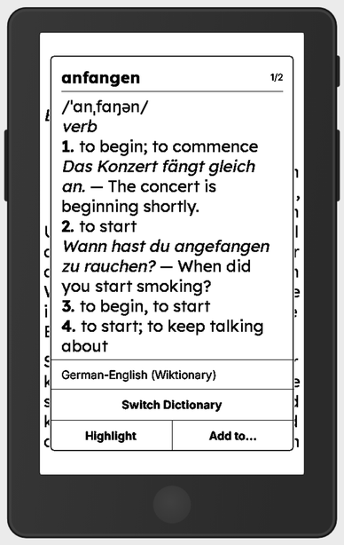

---

## 3. Touch word selection

<table>
  <tr>
    <td align="center" width="33%" valign="top">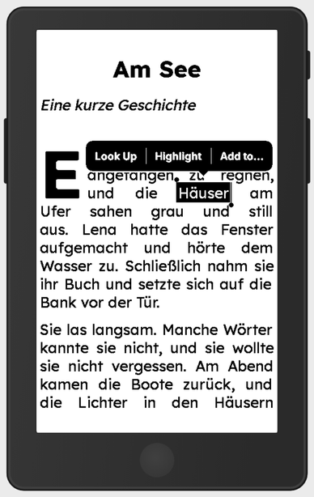 Hold a word until it is selected.</td>
    <td align="center" width="33%" valign="top">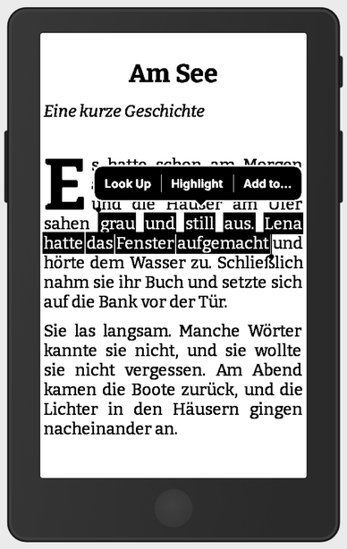 Slide (or press the buttons) to select more words; handles mark both ends.</td>
    <td align="center" width="33%" valign="top">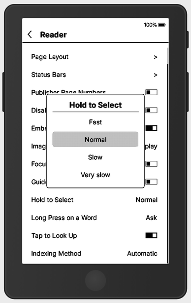 Settings → Reader → <b>Hold to Select</b>.</td>
  </tr>
</table>

### Three settings, three questions (1.2.1)
From 1.2.1 three settings in **Settings → Reader** share the work. Each answers
one question, and they do not change one another:

| Setting | The question it answers | Choices | Default |
|---|---|---|---|
| **Hold to Select** | How long must my finger rest on a word before it is selected? | Fast, Normal, Slow, Very slow | Normal |
| **Long Press on a Word** | What happens when I lift my finger after selecting? | Look Up, Ask, Highlight, Add to… | Ask (from 1.3.0; Look Up before) |
| **Tap to Look Up** | Does a short tap on a word open its meaning? | Off, On | Off |

**What changed for Hold to Select.** Up to 1.2.0, holding a word had one
result: lifting your finger opened the dictionary. Hold to Select still sets
only the waiting time, exactly as before, but what follows the hold is now
your choice in **Long Press on a Word**. With the defaults nothing is
different from 1.2.0. And with **Tap to Look Up** on, a hold is no longer the
only way to a meaning: a tap looks a single word up, and the hold is left for
several words, for highlighting, or for whatever Long Press on a Word is set
to.

What each touch does in a book:

| Touch | Tap to Look Up off (default) | Tap to Look Up on |
|---|---|---|
| Short tap on a word | turns the page | opens the word's meaning |
| Short tap beside the text | turns the page | nothing |
| Tap on a link or footnote | follows it | follows it |
| Swipe left or right | turns the page | turns the page |
| Page buttons | turn the page | turn the page |
| Hold a word (for the Hold to Select time) | selects it; slide for more words | the same |
| Lift after a hold | does what Long Press on a Word says | the same |

A tap always looks up, whatever Long Press on a Word is set to. So you can, for
example, set Long Press on a Word to **Highlight** and Tap to Look Up to
**On**: a tap gives the meaning, a hold marks the passage.

  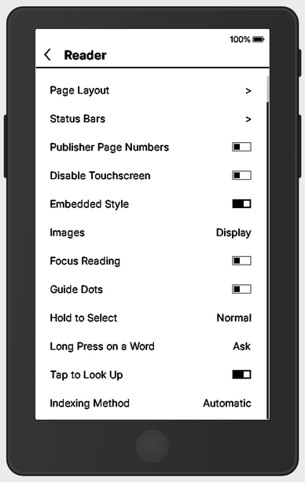

All three are shown only on readers with a touchscreen (the X4 Classic and
X3 / X4 select with the buttons: see [section 21](#21-readers-without-touch)),
and all three need a dictionary for the book (see [Remembers your dictionary](#remembers-your-dictionary)).
Without one, a hold does nothing and taps keep turning pages.

### Hold to Select
**Settings → Reader → Hold to Select** sets how long you hold a finger on a
word before it is selected:

| Option | Hold time |
|---|---|
| Fast | 0.35 s |
| Normal (default) | 0.45 s |
| Slow | 0.7 s |
| Very slow | 1 s (the fixed time CrossInk used) |

It applies in books and when you hold a word inside a dictionary definition to
look that word up too. The setting is shown only on readers with a touchscreen.

**How to use it:** hold a word until it is selected. Keep your finger down and
slide it to select more words; the selection can continue onto the next page.
Lift your finger, and the reader does what **Long Press on a Word** is set to
(below): by default it looks the word or phrase up, as it always did.

If pages turn when you meant to select, choose a shorter time; if words get
selected when you only rested your finger, choose a longer one. With Tap to
Look Up on, a touch shorter than this time counts as a tap and looks the word
up, so the time also decides where a tap ends and a hold begins.

### Selection handles
While you select with your finger, each end of the selection has a bar, with a
round knob above the start and below the end, as on a phone. The handles show
exactly what is selected. To change the selection, keep sliding your finger.

### Resize a selection (1.3.0)
With Long Press on a Word set to **Ask**, the selection stays after you lift
your finger, and you can change it:

- drag the handle at either end, or
- press Right / Down / page forward to add the next word, and Left / Up / page
  back to take one off. One press is always one word as it looks on the page.

  

### Long Press on a Word (1.2.1)
**Settings → Reader → Long Press on a Word** sets what happens when you lift
your finger after selecting (how long you hold first is Hold to Select, above):

| Option | What it does |
|---|---|
| Look Up (default up to 1.2.1) | opens the dictionary at once, as before |
| Ask (default from 1.3.0) | keeps the words selected and shows a bubble at them: **Look Up**, **Highlight**, **Add to…** |
| Highlight | saves the selection as a highlight at once |
| Add to… | opens the list of Highlights categories at once |

With **Ask**, a tap on one of the three acts, and a tap anywhere else puts the
selection away. A word sent to **Flashcards** from the bubble (or with Add to…)
is looked up first, so the card gets its meaning.

  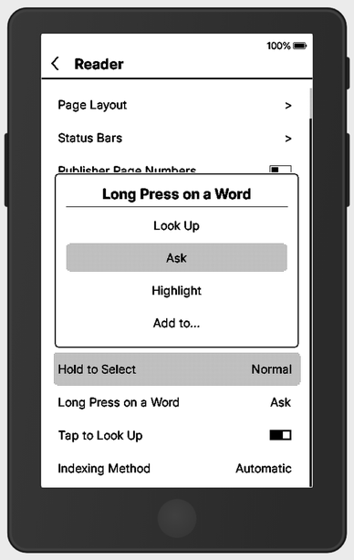
  
  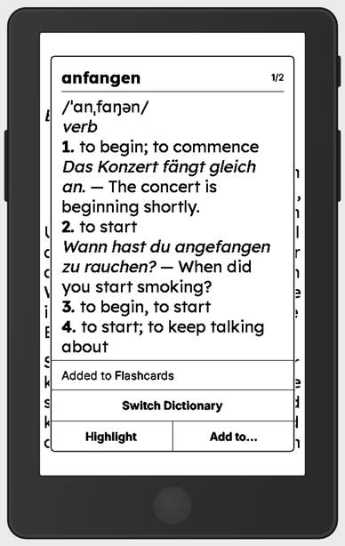

### Tap to Look Up (1.2.1)
**Settings → Reader → Tap to Look Up** (a switch, off by default): a tap on a
word opens its meaning at once, with no holding. It is made for reading in a
language you are learning, where you look up many single words.

While it is on:

- **A tap never turns the page.** Swipe left or right, or use the page
  buttons. A tap beside the text does nothing.
- **A tap always looks up**, also when Long Press on a Word is set to Ask,
  Highlight or Add to…. The popup is the usual one, with **Highlight**,
  **Add to…** and **Switch Dictionary**.
- **Holding works as before:** hold for the Hold to Select time to select a
  word, slide for more words, and lifting does what Long Press on a Word says.
  To look up a phrase of several words, hold and slide.
- **Links and footnotes** still open with a tap.
- **The end-of-book screen** is not affected.

It needs a dictionary for the book: without one, taps keep turning pages.
Switch it off again in the same place to get tap-to-turn back.

  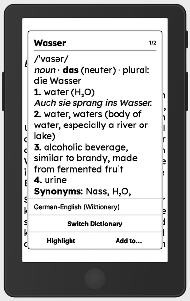

---

## 4. Highlights

"Clippings" are now called **Highlights** everywhere.

### Highlights hub on the Home screen
**Home → Highlights** is always shown and opens:

| Row | What it holds |
|---|---|
| Favorite Lines | sentences and passages you save |
| Flashcards | words to learn (see section 5) |
| your own categories | anything you want, such as "Verbs" or "Poems" |
| By Book | each book's bookmarks and highlights (the previous screen) |
| New Category | create a category with the on-screen keyboard |

- **Rename** a category: hold its row.
- **Delete** a category: swipe its row left and tap Delete. Favorite Lines,
  Flashcards and By Book cannot be deleted.
- Up to 32 categories.

### Add to… from the dictionary

  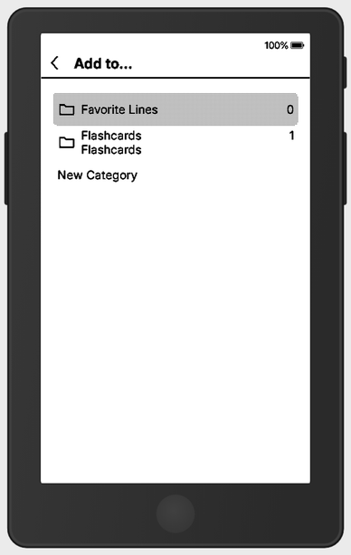 
  <b>Add to…</b>: pick Favorite Lines, Flashcards or one of your categories, or create a new one.

The dictionary popup has two buttons below the definition: **Highlight** and
**Add to…**. **Add to…** lets you pick a category:

- In **Flashcards**, the word is saved with its meaning (up to about 1,500
  characters, taken from the dictionary on screen). The card keeps working if
  you later remove or change dictionaries.
- In any other category, the word is saved.
- When the selected text is not in the dictionary (for example a whole
  sentence), **Add to…** saves the text itself, handy for Favorite Lines.

### Reading a category
Tap an entry to read it in full, and swipe an entry left to delete it.

Highlights are plain text files in `/.crosspoint/highlights/` on the SD card,
so they survive firmware updates and can be copied off the card.

---

## 5. Flashcards

<table>
  <tr>
    <td align="center" width="33%" valign="top">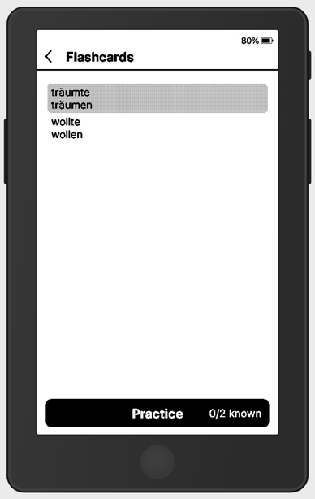 The Flashcards list with the <b>Practice</b> button and how many cards you know.</td>
    <td align="center" width="33%" valign="top">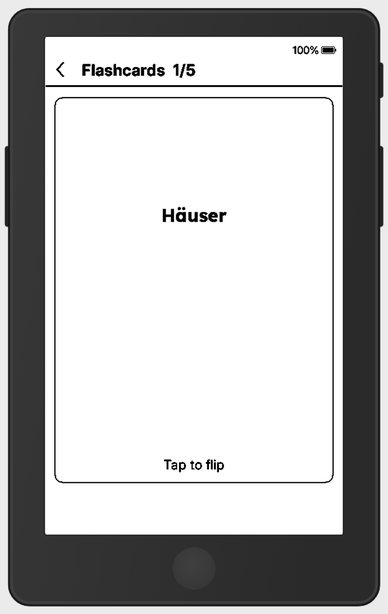 Front of a card: the word. Tap to flip.</td>
    <td align="center" width="33%" valign="top">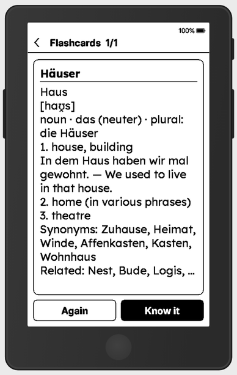 Back of the card: the saved meaning with its pronunciation, then <b>Again</b> or <b>Know it</b>.</td>
  </tr>
</table>

The Flashcards category has a **Practice** button at the top that shows how
many cards you already know.

- A card shows the word. **Tap to flip** it and see the meaning.
- Choose **Again** or **Know it**.
- Cards are sorted into Leitner boxes 1–5: **Know it** moves a card up one box,
  **Again** sends it back to box 1. Cards in lower boxes come first, so words
  you miss come back sooner. A card counts as known from box 4.
- At the end: "All cards reviewed" and **Start Over**.
- Progress is saved on the SD card next to the cards.
- German, English, Persian and IPA display correctly on the cards and in the
  list with any SD-card font. Earlier builds showed boxes here. From 1.3.1 the
  back of a card shows the word's pronunciation with the built-in fonts too.

---

## 6. Swipe to delete

  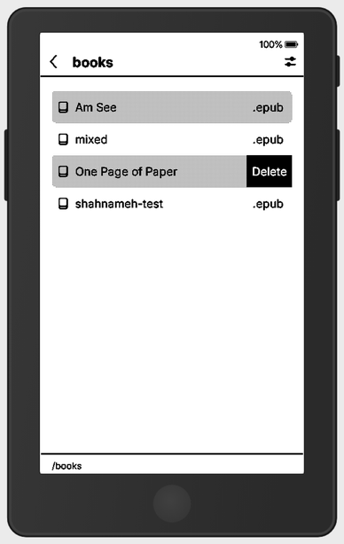 
  A book swiped left in the File Browser, showing <b>Delete</b>.

Swipe a row **left** to reveal a **Delete** button, then tap Delete. Tapping
anywhere else, swiping right or pressing any button hides it again.

| Screen | What Delete removes |
|---|---|
| File Browser | the **file** from the SD card (files only; folders still use the action menu) |
| Recent Books | the entry from the list only; the book file stays |
| Highlights hub | a category you created |
| A highlights category | that entry |
| Bookmarks (in a book) | that bookmark |
| Highlights (in a book) | that highlight |
| Lookup history | that word |

---

## 7. Speed, pictures and battery

VARAGH 1.1.0 "Tiger" is about speed and picture quality; the battery savings
from 1.0.0 stay. There is nothing to switch on: everything in this section
works by itself, except the optional Faster Screen Link. 1.3.1 adds faster
picture pages.

### Faster picture pages (1.3.1)

While you read, the next page's pictures are prepared in the background, so
turning to a picture page skips the wait. On the X4 Pro a picture page also
skips one extra screen pass.

| Reader | Picture page before | Picture page in 1.3.1 |
|---|---|---|
| X4 Pro | 3–4 s | about 1.2 s |
| X3 / X4 | 3–5.5 s | about 2.5–3 s |

  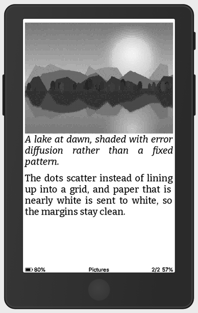

### Smoother, sharper pictures in books (1.1.0)

- Pictures are shrunk by **averaging** every pixel of the original (1.0.1 picked
  every n-th pixel and skipped the rest, which made lines jagged).
- Greys are drawn with **error diffusion**: fine, even dots instead of the fixed
  crosshatch pattern of 1.0.1. Gradients such as skies and faces look smooth.
- A **levels** step turns nearly-white areas white and nearly-black areas black,
  so the paper of scanned pages stays clean instead of turning speckled grey.
- Pictures you already viewed are prepared once more the first time you see
  them after updating. Enlarged pictures keep the previous method, which suits
  enlarging better.

The close-ups below show the same part of the same picture at the same size,
enlarged 2×. Each shows exactly the 4 greys the X4 Pro screen receives,
computed on a computer by VARAGH's own picture code from test pictures.

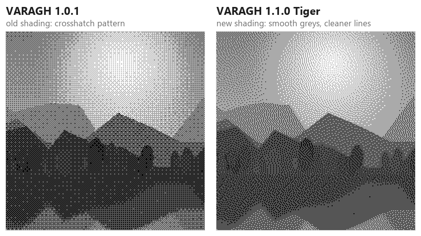

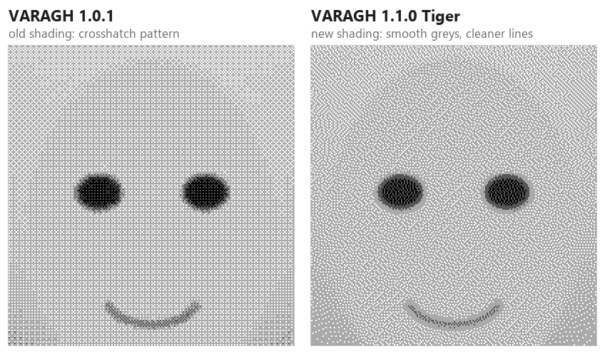

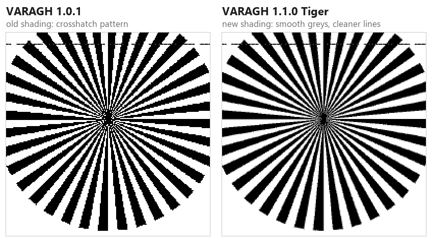

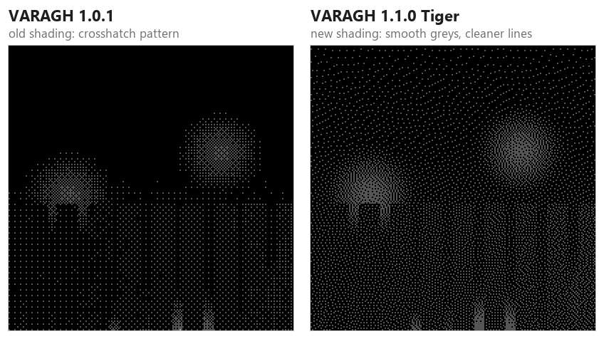

### Chapters open faster (1.1.0)

- **Indexing Method: Automatic** (new default). Before a chapter can be shown,
  the reader lays it out into pages ("indexing"). Normal-size chapters (up to
  32 KB of text) are indexed completely, as before; long chapters show their
  first page right away and are indexed a few pages ahead while you read. You
  can still choose Full Section or Incremental in **Settings → Reader →
  Indexing Method**, or for one book in the reader menu → Reader Options.
  [How indexing works](docs/epub-indexing.md).
- **No "Indexing" popup for quick chapters.** Drawing the popup and the extra
  screen cleaning it caused took about 2.4 seconds, longer than indexing a
  normal chapter.
- **Pages are written to the SD card in large pieces** instead of hundreds of
  small writes: writing was about half of the indexing time.
- **The SD card runs at 40 MHz** (its high-speed mode) instead of 20 MHz: reads
  are about 70% faster. A card that cannot start at 40 MHz falls back to 20 MHz
  by itself.
- **Fonts stay in memory.** Letter shapes of SD-card fonts such as NotoVazir are
  kept in the X4 Pro's 8 MB memory once read, so page turns and indexing no
  longer read them from the card again.
- The book, picture and drawing code is compiled for speed instead of size.

### Battery

- **Display power-off when idle (1.0.0).** After a quick page turn the display
  controller used to keep its power stage running until the next refresh.
  VARAGH turns it off 5 seconds after the screen stops changing, and the next
  refresh turns it back on. Checked against all three X4 Pro panel controllers
  (SSD1677, UC8179, UC8279). Nothing changes on screen.
- **The processor slows down sooner (1.1.0):** 1 second after the last button
  press or touch instead of 3, and also while the screen refreshes. Buttons and
  touch still respond immediately.
- **Faster text drawing** (1.0.0), ported from CrossPoint #3633.
- **Less memory per SD-card font** (1.0.0): fonts share their character tables,
  ported from CrossPoint #3616.
- The Persian/IPA fallback font loads only when a book or screen needs it,
  and reads character widths from the SD card only when needed.
- **X3: the right battery size (1.3.1).** The battery gauge is told the real
  650 mAh battery, so the percentage stays right after the battery runs flat.

### Faster Screen Link (1.1.0, optional)

**Settings → Display → Faster Screen Link** (off by default) sends each screen
image to the display at 20 MHz instead of 10 MHz, on X4 Pro screens with the
SSD1677 controller. After you turn it on, the reader asks you to confirm within
10 seconds that the screen looks right; without confirmation, or if you leave
Settings first, it switches back by itself. It can only be turned on on the
reader, not from the web settings page.

### Speed log (1.1.0)

The reader writes timings to `/.crosspoint/speed-log.csv` on the SD card: page
turns, chapter indexing (split into its steps), pictures, opening books and
loading Home, plus a battery reading every 5 minutes. It holds timings and
device state only, never titles or text. Send it along when you report that
something is slow.

---

## 8. Clock: summer time, sync and Live Clock

  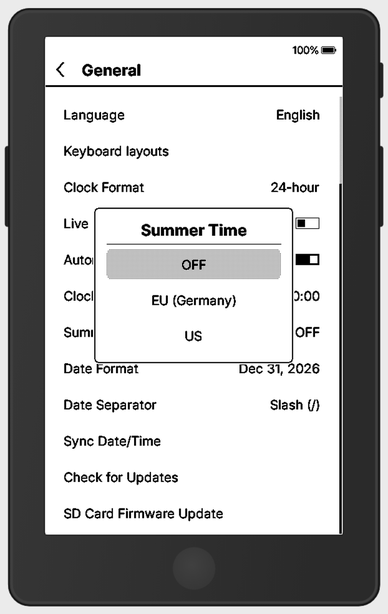 
  Settings → General → <b>Summer Time</b>, beside Live Clock and Automatic Time Zone.

**Settings → General → Summer Time** (up to 1.3.0: Settings → System → Device): Off, EU (Germany) or US. On
readers with a clock, the time then changes automatically on the right dates.
It applies to the clock, reading statistics, the dates saved with highlights,
and file dates on the SD card.

### A clock that stays right (1.3.1)
- **Synced on every Wi-Fi connect**, at most once an hour, not only the first
  time.
- **Automatic Time Zone** (on by default) sets the GMT offset, summer time
  included, from where the network is. Turn it off to set the offset by hand.
- **Live Clock** (off by default): the clock in the reader and on Home updates
  when the minute changes, with a quick update that does not flash and does not
  count toward full refreshes. Pages with pictures wait for the next page turn.

---

## 9. Pronunciations in menus

The built-in menu font (Inter) now includes the IPA letters (U+0250–02FF) at
sizes 8, 10 and 12. Pronunciations in lists and menus, such as the flashcard
list, display correctly instead of as boxes.
You can see it in the [Flashcards list](#5-flashcards): the lines under
*Fenster*, *Wasser* and *langsam* show their pronunciations. From 1.3.1 the built-in reading fonts have
them too (see [section 1](#built-in-on-every-reader-131)).

---

## 10. VARAGH name and logo

- **Logo** (new in 1.2.1): an open book with a V and a turning page.
- **Boot screen**: the VARAGH logo with "VARAGH" and "Booting", and at the bottom
  the version with its animal: a tiger up to 1.2.1 (**1.2.1 Tiger**), a lion from
  1.3.0 (**1.3.1 Lion**). The bottom of Settings shows **VARAGH 1.3.1 Lion** in
  the same way.
- **Default sleep screen** (when no custom sleep image is set): the VARAGH logo
  with "VARAGH" and "Sleeping"; light lines on black in dark mode.

  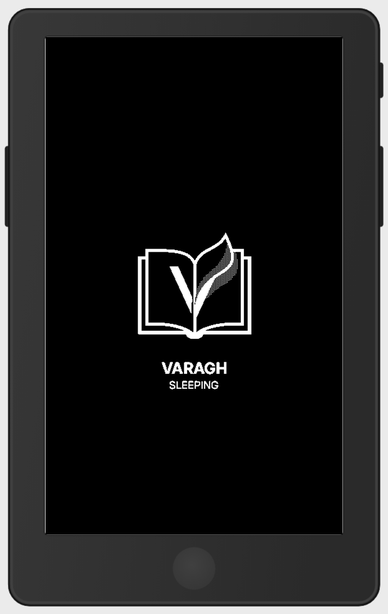
  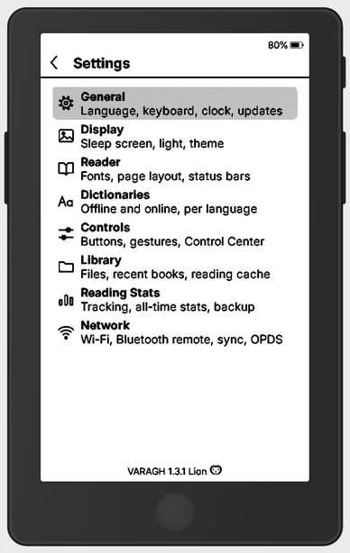

- "VARAGH" in every place the menus said "CrossInk", in every UI language.
- Web file manager: VARAGH logo, name and page titles.
- Network names: Wi-Fi hotspot **VARAGH-Reader**, network name **VARAGH-xxxx**,
  web address **http://varagh.local**, device name **VARAGH X4 Pro**.
- Version numbers start at 1.0.0.
- New menus and messages are in English and German, and from 1.3.0 in Persian;
  other languages show them in English.

---

## 11. Safe updates

- **Online updates** (Settings → System → Check for Updates) come from VARAGH's
  own GitHub releases, never from CrossInk.
- **Warning before every firmware install**, online or from the SD card:
  installing a CrossInk (or CrossPoint) release replaces VARAGH, and you lose its
  features (highlights, flashcards, German dictionary tools, Persian fonts,
  battery savings).
- When there is no release yet, the reader says **"No update available"**
  instead of showing an error.
- **Menu languages come from the same release** (1.3.0): a language marked
  "(download)" in the language list is fetched over Wi-Fi from the VARAGH
  release that matches your firmware, or copied to the card from the
  `languages` folder of the release zip.

---

## 12. Apps

New in 1.2.0. **Apps** on the Home screen opens a tile per app (every theme;
from 1.3.0 also on the X4 Classic and X3 / X4, played with the buttons:
see [section 21](#21-readers-without-touch); in Cover Grid it is the icon of four squares under the covers). **Manage**, top right, lists the apps with a
switch each: an app that is switched off is hidden. The apps are part of the
firmware; a hidden or closed app uses no memory, processor time or battery.
Every game is saved after each move, so leaving it or letting the reader sleep
loses nothing. From 1.2.1, waking the reader returns to the app that was open
when it went to sleep, as it does to the page of a book. From 1.3.0, a button
that has to be held (New game, Give up) shows "Hold to …" for two seconds when
you only tap it.

  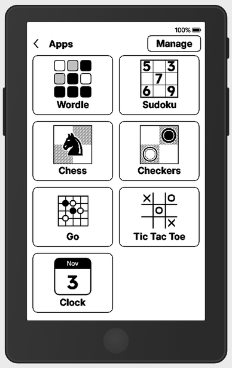
  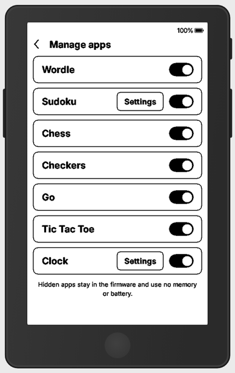

### Wordle

- Find the five-letter English word in six tries. Black = right letter in the
  right place, grey = in the word but elsewhere, faded = not in the word. The
  keyboard keys carry the same marks.
- Tap any box of the row you are typing to put the next letter there.
- About 1,900 everyday answers; about 22,000 English words are accepted as
  guesses.
- **Give up** (top right) has to be held. After a round: your statistics, and
  **Look up word** opens the answer in your English dictionary.

### Sudoku

- Tap a cell, then a number. Five levels (Expert and Master are new in 1.3.1)
  and a **Daily** puzzle, one new one each day, with the days in a row you
  solved it. Every puzzle has exactly one solution, and Easy and Medium can be
  solved without guessing.
- **Explaining hints (1.3.1):** a hint marks a cell and says why its number
  goes there ("Only number that fits", "Last empty cell", "Only place for 6"),
  with **Got it** or **Show answer**.
- **Notes**: switch it on and the number keys write small numbers into the
  cell, or hold a number key for half a second to write the other kind without
  switching. **Fill** writes every still possible number into all empty cells.
- Undo, Erase and Hint. Each number key shows how many of that digit are still
  missing.
- A wrong digit is not marked and mistakes are not counted while you play.
- **Answer check (1.3.1):** when the grid is full but not solved, a panel says
  how many answers are wrong, with **Show wrong**, **Clear wrong** and **Keep
  looking**.
- **New** (top right) has to be held.
- **Sudoku settings (1.3.1)** in **Apps → Manage → Sudoku → Settings**, one
  switch each:

  | Switch | What it does | Default |
  |---|---|---|
  | Explaining hints | a hint shows why, not only the answer | on |
  | Daily puzzle | one new puzzle each day | on |
  | Live mistake check | cross out a wrong number at once | off |
  | Repeated numbers | underline a number that repeats | off |
  | Number painting | pick a number first, then tap cells | off |
  | Fill last cell | fill a row, column or box one cell short | off |
  | 3-mistake limit | the game ends at the third mistake | off |
  | Restart button | start the same puzzle again | off |
  | More statistics | averages and daily runs | off |

  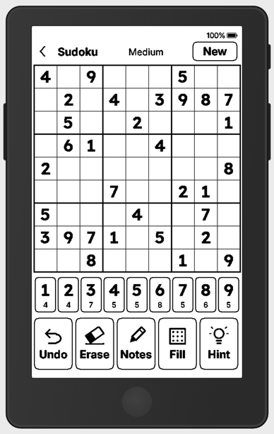
  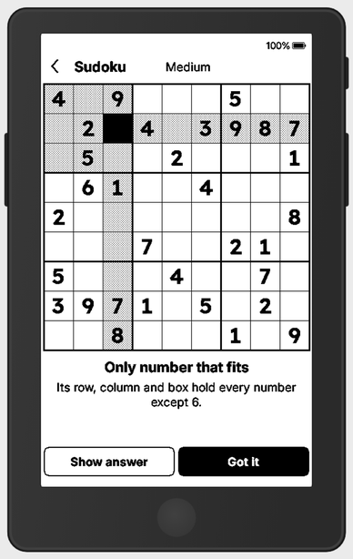
  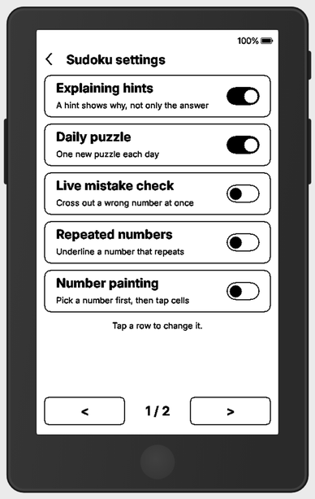

### Chess

- Against the computer (Easy, Medium, Hard) or two people on one reader, as
  White or Black.
- Tap a piece and dots show where it may go; the last move is marked.
- All rules, including castling, en passant, promotion with a choice of piece
  and the draws.
- Undo, Hint and Flip. The computer answers within 1.5, 2.5 or 5 seconds,
  depending on the level.
- From 1.2.1 the computer sees further in the same time, most of all on Hard,
  which thinks as deep as its five seconds allow.

### Checkers

- American / English rules: pieces move and capture forwards, kings one square
  in any direction, a capture must be taken and a multiple jump finished.
- Against the computer or two players. Undo and Hint.

### Go (1.3.0)

- 9×9, 13×13 or 19×19, against the computer (Easy, Medium) or two players.
- Tap a point twice to place a stone (the first tap shows where), or move with
  the buttons.
- Undo, Pass, Hint and a score at the end.

  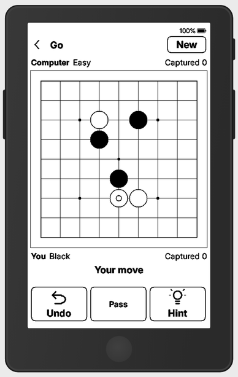

### Tic Tac Toe (1.3.0)

- Classic or infinite, against the computer or two players.

### Clock

- The time above a month calendar, repainted once a minute while it is open.
  It uses the reader's clock, which from 1.3.1 is set on every Wi-Fi connect
  (see [section 8](#8-clock-summer-time-sync-and-live-clock)).
- Tap the clock to step through three faces: large digits, an analog clock, and
  a calendar with the Persian day under every date.
- The arrows or a swipe turn the months; tap the month's name to return to
  today.
- **Manage → Clock → Settings**: clock face, Persian date on or off, first day
  of the week (Monday, Saturday or Sunday), week number on or off.
- **Sleep screen**: Settings → Display → Sleep Screen → **Clock & Calendar**
  shows the weekday, a large day number, the month, the Persian date and the
  month's calendar. The reader is off while it sleeps, so there is no time on
  it, and the date is the one of the moment it went to sleep.

---

## 13. Online dictionary

New in 1.2.0. In a word lookup, **Switch Dictionary** ends with **Online
(Wiktionary)**.

- It asks Wiktionary in the language of the word (English, German or Persian)
  and, when Wiktionary has no entry, Wikipedia for a short summary.
- The answer is laid out like the VARAGH dictionaries and saved on the card, so
  the same word is answered offline from then on.
- Normally Wi-Fi is only on for the lookup: the reader restarts into its Wi-Fi
  mode and back into the book, about 10 to 15 seconds for a new word.
- **Settings → Reader → Online Lookup: Keep Wi-Fi On** (off by default,
  experimental): Wi-Fi is joined in the background while a book is open and a
  new word is fetched in a few seconds, without the restarts. Reading uses the
  battery faster while it is on; the reader asks before switching it on. When
  Wi-Fi is not there, the lookup takes the restart route.
- From 1.2.1 a lookup never holds the page for long: Back (the Home key) gives
  it up at once, and a site that does not answer is given up on after 8
  seconds. With Wi-Fi connected but Wiktionary out of reach, the reader says so
  and stays in the book.
- From 1.3.0 there are more online sources, and each language picks its own:
  see [section 15](#15-dictionaries-for-every-language).

---

## 14. Book ratings

New in 1.2.1. Five stars with halves. Tap the left half of a star for half of
it, the right half for all of it, and the value that is already set to take
the rating away.

| Where | What you see |
|---|---|
| End of a book | the book's title and a row of stars to tap |
| Book menu (hold a book in Files or Library) | **Rating** at the top (first in Library, after Rename in Files), with its stars; it opens the rating screen |
| Reading Stats | the stars in the title strip of the book's card; tap the strip to rate |
| Library list | a rated book's stars at the end of its row |

A rating is saved the moment you give it:

- in `/.crosspoint/ratings.txt` on the card, one line a book (stars, title,
  author, file, separated by tabs). It is plain text, so it can be read or
  copied on a computer, and it survives firmware updates and a cleared cache;
- and beside the reader's other data for that book.

When the reader moves or renames a book (for example into the Read folder when
you finish it), its rating goes with it. The rating is not written into the
book file itself.

  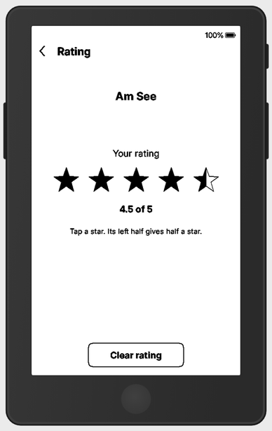
  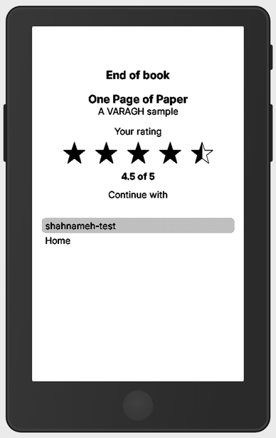
  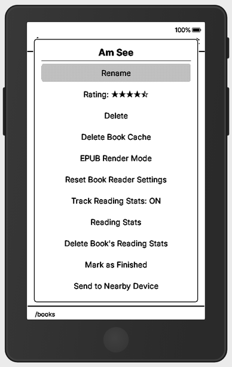
  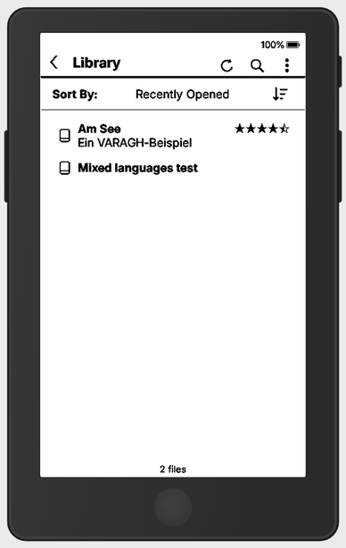
  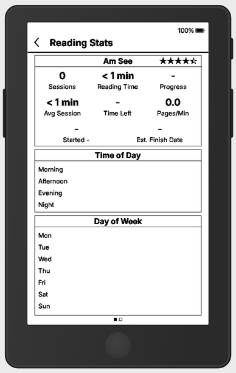

---

## 15. Dictionaries for every language

New in 1.3.0. **Settings → Dictionaries** (in 1.3.0: Settings → Reader →
Dictionaries) is one page for every language you read.

  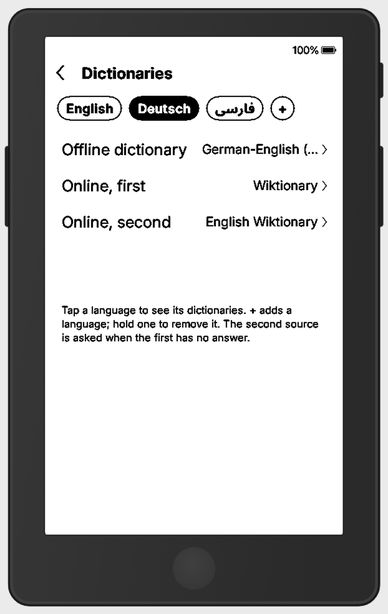
  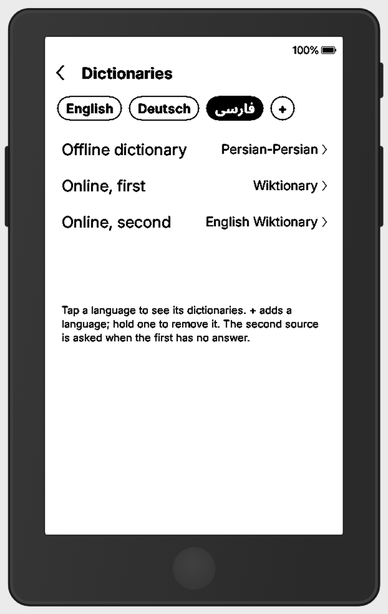
  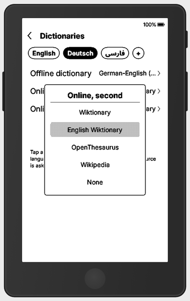

- **A tab per language.** **+** adds a language (English, Deutsch, فارسی,
  Français, Español, Italiano, Nederlands, Português, Русский, العربية, Türkçe,
  Polski); holding a tab removes it.
- **Its own dictionaries.** Each language has an offline dictionary on the card
  and a first and second online source. A language without a choice gets one
  from the card by itself, a dictionary in the same language first (such as
  German–German). If the card has none, the page says so and names the folder
  to copy one into.
- **The book's language decides.** A book looks words up in the dictionary of
  its language; Persian words use the Persian dictionary in any book.
- **Keep Wi-Fi on in books** is on the same page.
- Works with touch and with the buttons (Left / Right switch the language,
  Up / Down and Confirm pick a row).

### More online sources

| Source | What it gives |
|---|---|
| Wiktionary | meanings in the language of the word (from 1.2.0) |
| Wikipedia | a short summary when Wiktionary has no entry (from 1.2.0) |
| **Datamuse** | English meanings from WordNet |
| **OpenThesaurus** | German synonyms |
| **English Wiktionary** | meanings in English of German, Persian and other words |

- The lookup popup names the source ("Online: Datamuse") and offers **Try
  Another Source**. Answers are saved on the card per source.
- When a word is not in the card's dictionary and Wi-Fi is already on, the
  online sources are asked by themselves. Without Wi-Fi nothing is fetched
  unless you choose Online.

---

## 16. Control Center and night light

New in 1.3.0, on the X4 Pro (it needs the touch screen and the front light).

  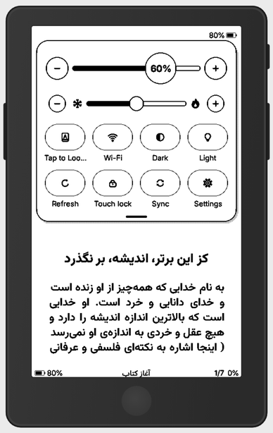
  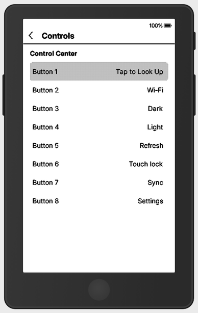

**Swipe down from the top edge of the screen** to open the Control Center. A
tap on the top bar still does what it did before.

- **Light:** a thin slider with the percentage in its knob. The left half
  covers 0–20 %, so low light can be set finely. Round **−** and **+** buttons
  beside it always move exactly 1 %.
- **Warmth:** a second slider, cold (snowflake) on the left and warm (flame) on
  the right, with its own − and +.
- **Eight buttons you choose** in **Settings → Controls → Control Center**,
  from: Tap to Look Up, Wi-Fi, Dark, Touch lock, Light, Night light, Guide Dots,
  Focus Reading, Refresh, Sync, Sleep, Settings, Reading stats, Library, Apps,
  File transfer, Rotate, or Empty. Empty places are left out and the card gets
  shorter. A button is black while its setting is on.
- **Wi-Fi:** a tap connects to a saved network in range; a hold opens the list
  of networks.

### Night light
**Frontlight → Night Light, Night From, Night Until** (in the Display
settings): from the evening time to the morning time the reader uses a second
brightness and warmth, then returns to the day values.

---

## 17. Settings in groups

New in 1.3.1, as in CrossPoint 2.0. **Settings** opens a list of eight groups,
each with an icon and a short line saying what is inside:

| Group | Its line on the reader |
|---|---|
| General | Language, keyboard, clock, updates |
| Display | Sleep screen, light, theme |
| Reader | Fonts, page layout, status bars |
| Dictionaries | Offline and online, per language (section 15) |
| Controls | Buttons, gestures, Control Center |
| Library | Files, recent books, reading cache |
| Reading Stats | Tracking, all-time stats, backup |
| Network | Wi-Fi, Bluetooth remote, sync, OPDS |

All VARAGH settings are kept. The side buttons move through the list.

  

---

## 18. Books as they were made

New in 1.3.1. Books are laid out again once, the first time each is opened.

<table>
  <tr>
    <td align="center" width="33%" valign="top">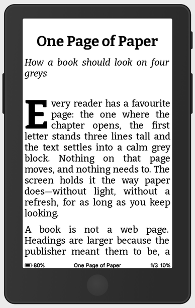 A drop cap over the first lines.</td>
    <td align="center" width="33%" valign="top">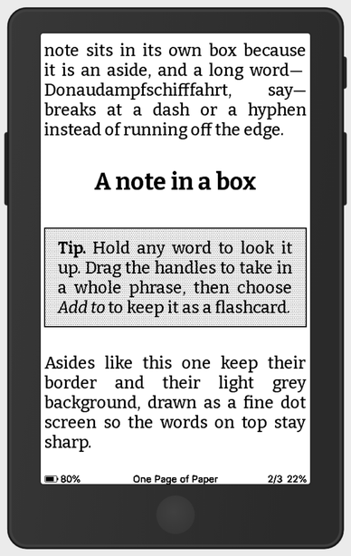 A bordered, lightly shaded box.</td>
    <td align="center" width="33%" valign="top">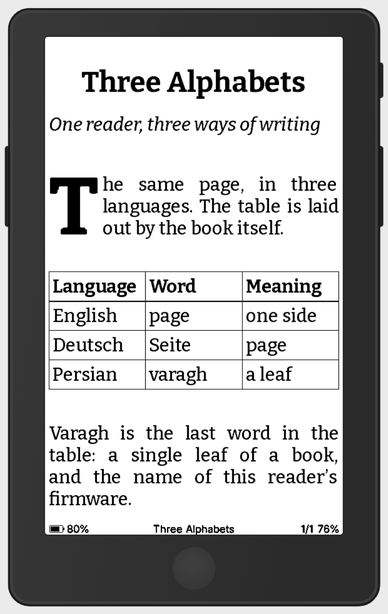 A table, as the book lays it out.</td>
  </tr>
</table>

- **Drop caps:** a book's big first letter (CSS `::first-letter`,
  `initial-letter` or a floated letter) spans the first lines, with built-in
  and downloaded fonts. Persian, Arabic and Hebrew letters are left as they are.
- **Text sizes:** CSS `font-size` on paragraphs and headings, and browser
  heading sizes (h1 twice the text size). With Embedded Style off or in Light
  mode, text keeps one size. Downloaded fonts do this too: the size is taken
  from the font sizes installed on the SD card, so installing more sizes gives
  closer matches.
- **Boxes:** CSS borders and light grey backgrounds around paragraphs. The grey
  is a light dot screen so the text on it stays clear.
- **Line breaks after hyphens and dashes** ("word—word" can break after the
  dash), also with Hyphenation off.
- **Next in series** (1.3.0): at the end of a book, the next book of its series
  comes first, from any folder.
- Fixes: chapters without a DOCTYPE line no longer stop at the first `&nbsp;`;
  a picture in a book's reading order gets its own page; the chapter list opens
  on the sub-chapter you are reading; books with thousands of chapters open.

---

## 19. Bluetooth page turner

New in 1.3.1, from CrossPoint 2.0. **Settings → Network → Bluetooth Page
Turner**:

- Scan, pair a remote and map its buttons: next / previous page, next /
  previous chapter, Confirm, Back, reader menu.
- In a book the status bar says "Connecting Bluetooth…" until the remote links.
- The radio only runs in a book (and while pairing), stops before sleep and
  pauses while a chapter is being laid out, to save battery.

---

## 20. Icons, rotation and battery icon

New in 1.3.0.

- **One icon style everywhere.** Every icon (Home, Library, files, reader,
  keyboard, Control Center) is redrawn in one bold-line style made for e-ink:
  lines 2.8 px wide on whole pixels, no grey.
- **Rotation turns the buttons and the touch screen with the page.** "Turned
  right 90°" and "Turned left 90°" always turn exactly 90° that way, and the
  front buttons and touch follow, so the forward button is still forward. The
  sleep screen is always drawn upright.
- **Battery icon:** a new design in every theme, with the percentage beside it,
  a bolt while charging and "!" at 15 % or less.

  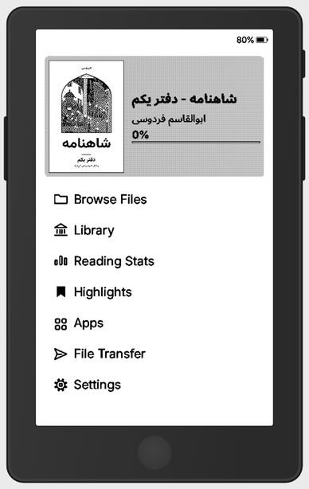
  

---

## 21. Readers without touch

From 1.3.0 VARAGH also runs on the **X4 Classic** and the **X3 / X4**, the same
version as on the X4 Pro. They have no touch screen or front light, so:

- **Apps with buttons.** Apps is on Home. A frame shows what is picked; the
  direction buttons move it and Confirm taps it. Hold Confirm on New / Give up.
  Clock: Left / Right change the month, Confirm the clock face.
- **Choices after a button selection.** In Menu → Look Up Word, hold Confirm on
  a word, add words with Left / Right and press Confirm: **Look Up**,
  **Highlight** and **Add to** appear, as on the X4 Pro. The side buttons pick
  one; Left / Right still change the selection.
- **Menu languages as downloads.** English and Deutsch are built in so the
  firmware fits; the other languages come over Wi-Fi or from the release zip
  (from 1.3.1 on the X4 Pro too). A language takes about 15–35 KB of memory
  while it is used.
- **Persian, German and pronunciations built in** (1.3.1), as on the X4 Pro.
- Not on these readers: the Control Center, front light, night light, warmth,
  Tap to Look Up and touch selection handles.

<table>
  <tr>
    <td align="center" width="33%" valign="top"> <b>X4 Pro</b>: the Control Center.</td>
    <td align="center" width="33%" valign="top">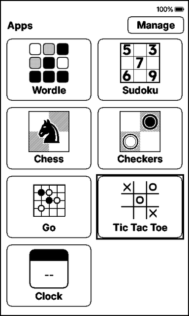 <b>X4 Classic</b>: Apps, the frame moved with the buttons.</td>
    <td align="center" width="33%" valign="top">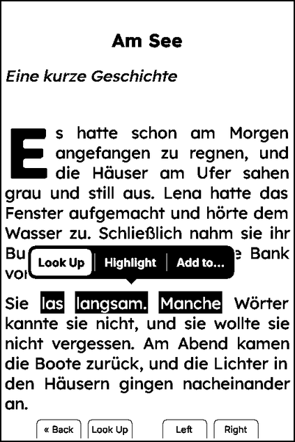 <b>X3</b>: three words picked with the buttons, then Look Up, Highlight, Add to.</td>
  </tr>
</table>

How to install on these readers: [README, Readers without touch](README.md#readers-without-touch).

---

## 22. For developers

- Licences: MIT like CrossInk and CrossPoint. Every library, font and data
  source is listed in [THIRD_PARTY_NOTICES.md](THIRD_PARTY_NOTICES.md), OFL
  licence texts were added for all built-in fonts, and each release includes a
  full-source zip (the firmware binary includes GPL-licensed wolfSSL).
- The display and UI library (FreeInk SDK) has VARAGH changes: the display idle
  power-off hook, a read-only touch hit-test used by swipe to delete, and in
  1.1.0 the 40 MHz SD card and the Faster Screen Link. The library with these
  changes is in each release's full-source zip and at
  [PewPewzxc/freeink-sdk](https://github.com/PewPewzxc/freeink-sdk).
- Three firmware builds from one source: PlatformIO environments `x4-pro`,
  `x4-classic` and `default` (X3 / X4). Menu-language packs (`*.lng`, at most
  64 KB each) are the same on every reader. Since 1.3.2 one set is kept in the
  release named after the menu text it fits (such as `lang-ECA0AA6E`), which is
  where every reader downloads them from; a pack that does not fit is refused.
- Unit tests: German stemming, summer-time rules, glyph drawing, highlight file
  format and storage, lookup-word cleanup; in 1.1.0 also the font memory copy,
  picture shading, the speed log and chapter-file writing; in 1.2.0 the rules
  of Wordle, Sudoku, chess (move generator checked against published position
  counts) and checkers, the calendar arithmetic and the online dictionary text.
- Book page caches were rebuilt once when installing 1.0.0 (layout format v78);
  1.1.0 keeps that format, so books are not indexed again. 1.3.0 (a Persian
  fix) and 1.3.1 (drop caps, text sizes, boxes) each lay books out again once,
  the first time each is opened.
- Guides: [fonts](docs/varagh/FONTS.md), [dictionaries](docs/varagh/DICTIONARIES.md),
  [keeping up with CrossInk and CrossPoint](docs/varagh/UPSTREAM-SYNC.md),
  [changelog](CHANGELOG.md).

---

## 23. Planned

- English, German and Persian dictionaries built from Wiktionary, trimmed for
  the reader and published separately under CC BY-SA 4.0.
- Regular merges of new CrossInk and CrossPoint features and fixes.
